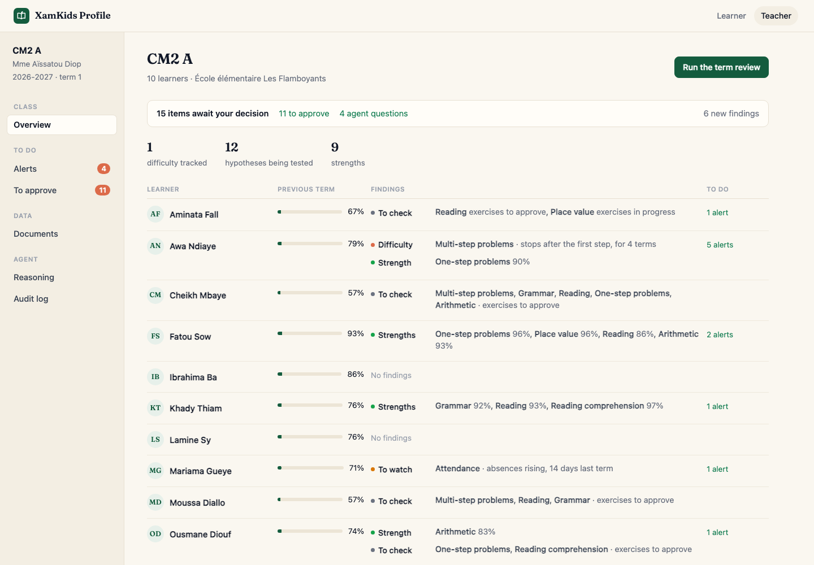
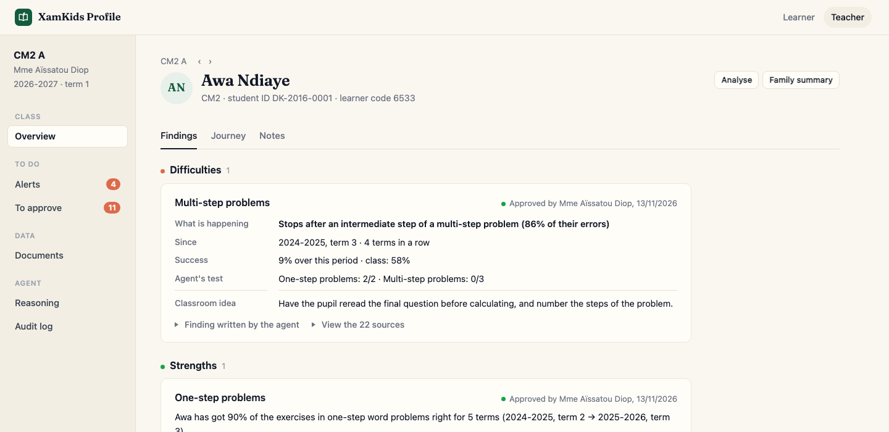
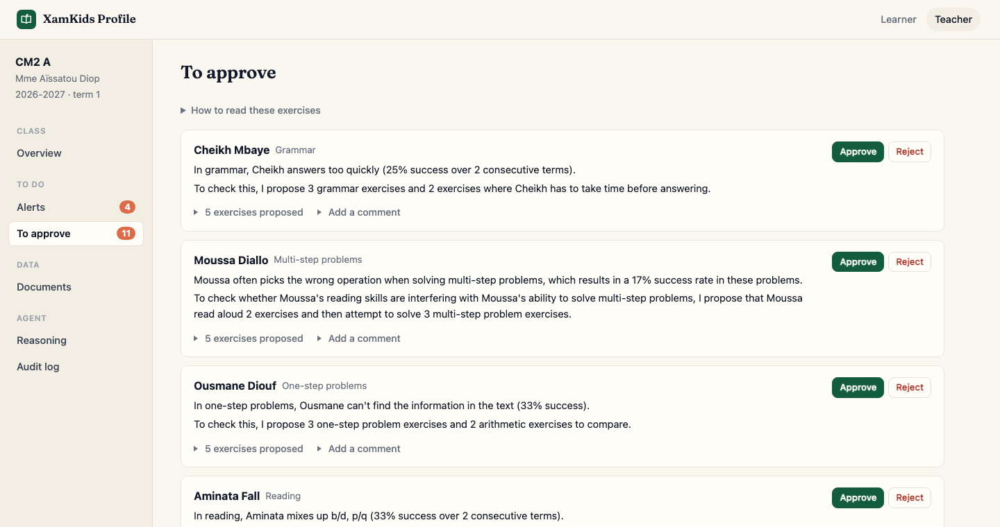
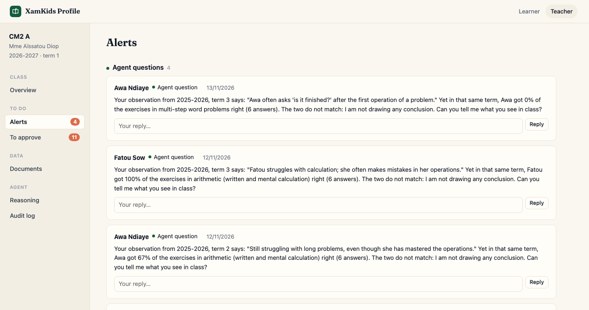
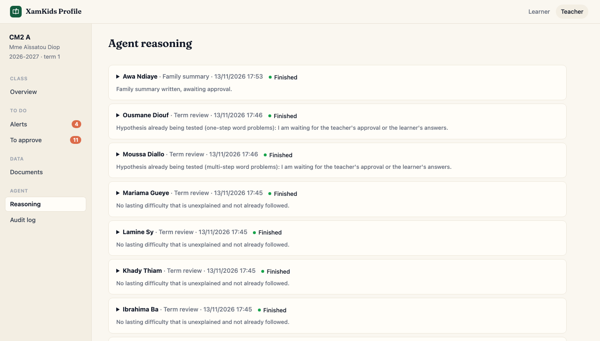
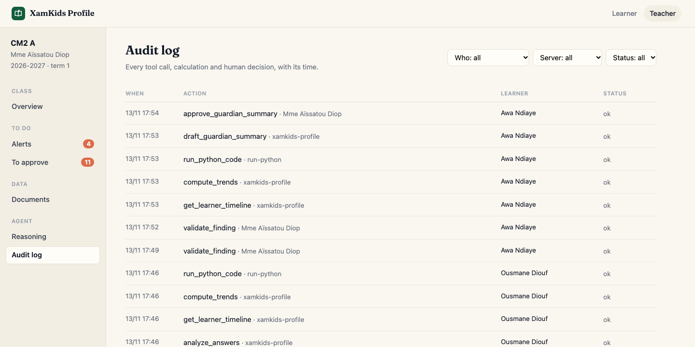
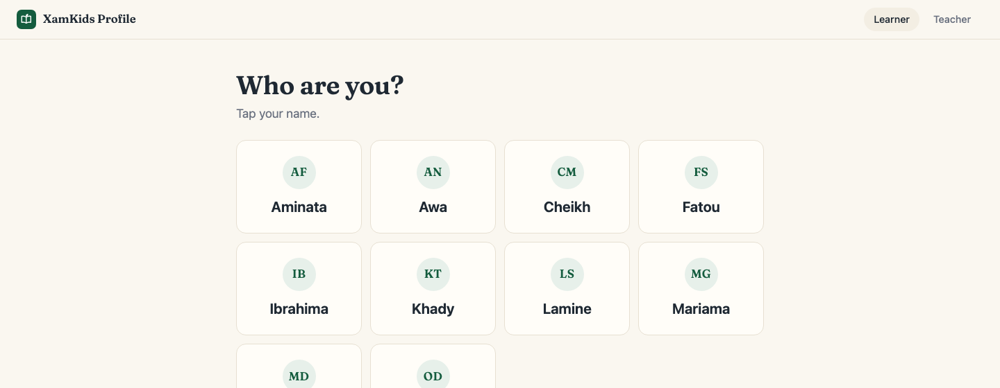
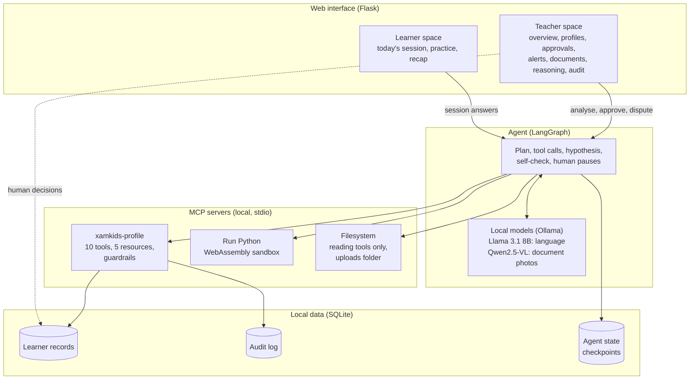
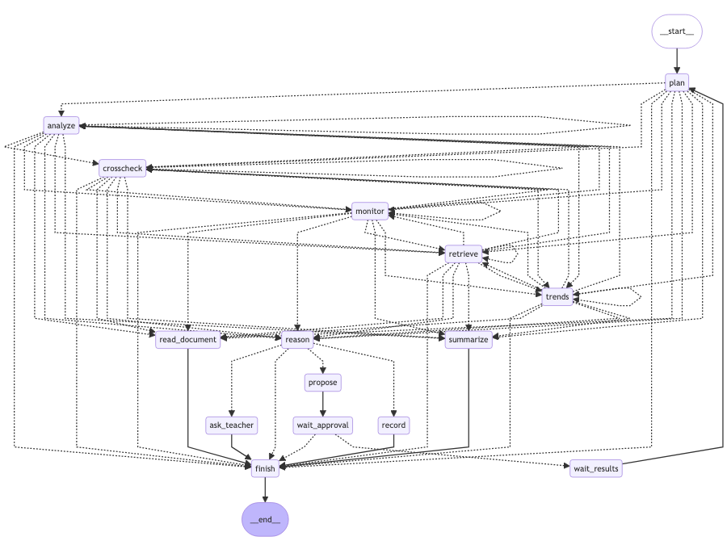

# XamKids Profile

**An AI agent that follows each child across the school years, finds what holds them back, and checks it before saying anything.**

Built for the *African Agentic AI Challenge*, Education track (Senegal). *Xam* means "to know" in Wolof.

> The model proposes, the code verifies, the teacher decides.



## Contents

- [The problem](#the-problem)
- [What XamKids Profile does](#what-xamkids-profile-does)
- [The platform](#the-platform)
- [Architecture](#architecture)
- [How the agent works](#how-the-agent-works)
- [MCP servers](#mcp-servers)
- [Safety and privacy](#safety-and-privacy)
- [Evaluation](#evaluation)
- [Getting started](#getting-started)
- [Demo scenario](#demo-scenario)
- [Project structure](#project-structure)
- [Limits and next steps](#limits-and-next-steps)

## The problem

In Africa, and particularly in Senegal, every child learns differently. But at school, what gets written down is a
grade, a rank, or a warning in the conduct notebook: "distracted", "careless work", "must try harder". Never the reason.

Classes are large (often 50 learners or more) and every year a new teacher starts from scratch. What the previous
teacher noticed is lost. A child who has struggled with the same thing for three years is described, year after
year, with the same sentence.

## What XamKids Profile does

- It keeps a **longitudinal record** of each child: answers to exercises, past report cards, attendance and
  teachers' written observations, over several school years and across schools.
- An **AI agent** finds what a child can do and what holds them back, describes it in plain words, and **tests its
  hypothesis** with a few short exercises before recording anything.
- It **never puts a label on a child**. No "dyslexic", no "lazy". It describes behaviour, for example
  "stops after the first step of a multi-step problem".
- The **teacher stays in control**: exercises, findings and messages to families all wait for the teacher's approval.
- Everything runs **locally**, on the school's computer, with open-weight models. Children's data never leaves the school.

## The platform

### Teacher space

| | |
|---|---|
| **Learner profile**: strengths, difficulties and points to watch, each with its sources, since when, and its status. |  |
| **To approve**: the agent's hypothesis and the check exercises it proposes. Nothing reaches a learner before the teacher approves. |  |
| **Alerts**: new findings, and questions the agent asks when a written observation contradicts the numbers. |  |
| **Agent reasoning**: every run, step by step: plan, tool calls, calculations, hypothesis, self-check. |  |
| **Audit log**: every tool call, calculation and human decision, with its time, inputs and outputs. |  |

### Learner space

A calm, simple space. The child taps their name, enters a 4-digit code and does "Today's session". Instructions can
be read aloud, a hint and a second try are available, and the session ends with encouragement, never a grade.
A learner never sees their profile or any comparison with classmates.



## Architecture



Four layers, all on one machine:

1. **Web interface**: a teacher space and a learner space.
2. **Agent**: a LangGraph state graph that plans, calls tools, decides, and stops whenever a human must decide.
3. **MCP servers**: the agent's only way to read or write anything.
4. **Local data**: three SQLite databases (learner records, audit log, agent checkpoints).

## How the agent works



*Graph generated from the code by LangGraph (`docs/agent_graph.mmd`).*

1. **Plan.** The agent reads the learner's situation and writes a plan with the local model. The plan is checked by
   code: missing prerequisites are added, forbidden steps are removed.
2. **Analyse and retrieve.** It classifies errors with a taxonomy and retrieves the whole history. If past years
   are missing, it asks the teacher for the report card by itself.
3. **Trends.** Trends are computed by the MCP server, then recomputed in the Python sandbox with the same code.
   A mismatch is logged and the server's result wins. The model never does the maths.
4. **Cross-check.** A written observation that contradicts the numbers becomes a question to the teacher, after
   the contradiction has been verified by calculation.
5. **Reason and self-check.** Rules always produce a decision from the numbers. The model may propose another one.
   `verify_decision` rejects it if the action is unknown, a label appears, a cited observation does not exist, the
   claimed number of terms does not match the calculation, or a difficulty is recorded without completed check
   exercises. When that happens, the trace says so: *"Self-check: model decision rejected"*, and the rules take over.
6. **Propose and pause.** The agent picks check exercises from a validated bank, including contrast exercises, then
   **pauses** (LangGraph interrupt) until the teacher approves, and again until the learner has done the session.
   Its state is saved, so it can wait for days and resume where it stopped.
7. **Conclude.** Confirmed, ruled out, another explanation to try, or not sure yet. A confirmed finding is recorded
   with its sources, the teacher is alerted, and the agent schedules its own follow-up check.

Without any model, the agent runs in **rules mode**: same steps, same tools, same guardrails.

To watch the agent live in a terminal while using the platform:

```bash
.venv/bin/python -m xamkids.live
```

## MCP servers

The agent connects to three MCP servers, all local, over stdio. `.mcp.json` declares the same three servers for any
other MCP client.

| Server | Role |
|---|---|
| **xamkids-profile** (ours, `xamkids/mcp_server.py`) | The only access to learner records. |
| **Run Python** (Pydantic) | Exact calculations in a WebAssembly sandbox that cannot read the machine's files. |
| **Filesystem** (official server) | Reads uploaded documents. Limited to the `uploads/` folder, and the agent is only given its four reading tools. |

**Tools of `xamkids-profile`:** `find_learner`, `get_learner_timeline`, `compute_trends`, `analyze_answers`,
`propose_exercises`, `check_finding`, `update_profile`, `alert_teacher`, `schedule_followup`,
`draft_guardian_summary`.

**Resources:** the error taxonomy, the exercise bank, the agent's rules, the class roster, a learner's situation.

**The guardrails live in the server, not in the prompt.** A finding is refused if it:

- contains a diagnostic word or a label;
- compares the child with the class;
- cites no source, an invented source, or a source that belongs to another learner;
- records a difficulty that has not been confirmed by check exercises approved by the teacher and done by the learner.

There is deliberately **no tool to approve**. Only a teacher can approve, from the interface.

## Safety and privacy

- **Local by design.** Models run on the machine with Ollama. No learner data is sent anywhere.
- **No labels, no ranking.** Rank and class averages are never imported from report cards.
- **Human in the loop.** Check exercises, findings and family summaries wait for the teacher. The agent never
  contacts a family.
- **Checked wording.** Sentences written by the model for the teacher are verified by code (`xamkids/wording.py`):
  every number must come from the computed facts. A refused sentence is replaced by a fixed one.
- **Asks instead of guessing.** Unreadable document, unknown learner, contradiction: the agent asks the teacher.
- **Full audit log.** Agent, tools, teacher and learner actions are all recorded.

## Evaluation

We asked an honest question: *do these tasks really need a language model?* The evaluation uses ten fictional
learners with five years of history, expected answers written by hand, and three runs per learner.
Full report: [EVALS.md](EVALS.md) (in French).

| Decision | Result |
|---|---|
| Choosing the hypothesis from the numbers | Rules find the right one for **9 learners out of 10**. The model never does better. So the code decides. |
| Reading what teachers write (contradictions), model checked by code | **5 correct out of 6**, and **0 false questions** to the teacher. |
| Same task, without the code's topic check | **16 false questions** in 30 runs. |
| Wrong contradictions proposed by the model and blocked by code | **79** in 30 runs. |

Conclusion: use the model where it really helps (reading free text), and let the code verify it.

The three MCP servers were also exercised by an external MCP client: 32 checks passed out of 32, including seven
forbidden attempts (labels, class comparison, missing or invented sources) that the server refused.

```bash
.venv/bin/python -m evals.run_evals --runs 3     # uses a throwaway database, never the platform's data
```

## Getting started

Requirements: Python 3.10 or later, [Deno](https://deno.com) (for Run Python), [Node.js](https://nodejs.org)
(for the Filesystem server), and optionally [Ollama](https://ollama.com/download) for the local models.

```bash
python3 -m venv .venv
.venv/bin/pip install -r requirements.txt

# optional: local open-weight models (without them, the agent runs in rules mode)
ollama pull llama3.1:8b
ollama pull qwen2.5vl:7b

XAMKIDS_LANG=en ./lancer.sh --reset     # creates the demo class in English and starts the platform
```

Then open the address printed in the terminal.

| Command | Effect |
|---|---|
| `./lancer.sh` | Starts the platform (French, the school language in Senegal, is the default). |
| `XAMKIDS_LANG=en ./lancer.sh --reset` | Recreates the demo class in English and starts. |
| `./lancer.sh --reset` | Starts again from a fresh demo class. |

Useful environment variables: `XAMKIDS_LANG`, `XAMKIDS_LLM`, `XAMKIDS_VLM`, `OLLAMA_HOST`.

## Demo scenario

The fictional class **CM2 A** has been followed since the first year of primary school, across two schools:
10 learners, more than 6,000 answers, attendance records and the observations of six successive teachers.

1. **Overview → "Run the term review".** The agent reviews the ten learners.
   *Awa* is good at arithmetic but has been failing multi-step problems for several terms.
2. **Agent reasoning.** Open Awa's run: plan, tool calls, sandbox calculation, hypothesis, self-check.
3. **To approve.** Read the hypothesis and the five check exercises, then approve.
4. **Learner → Awa → Today's session.** Answer the multi-step problems by stopping after the first step.
5. **Awa's profile.** The agent has resumed on its own: the difficulty is recorded with its sources and a follow-up
   is scheduled. The teacher approves or disputes it.
6. **Family summary.** Written only from findings the teacher has approved, and approved again before sharing.
7. **Documents.** Upload `samples/registre_presence_CM2A_oct2026.csv`: the agent spots an unknown learner and asks
   instead of guessing. Upload `samples/registre_flou.png`: unreadable, it asks for a better scan.
   Upload a report card (`samples/livret_Saliou_Kane.csv` or the photo `samples/livret_Saliou_Kane_CM1.png`):
   the agent reads it, checks each line and asks for confirmation before importing.

## Project structure

```
app.py                  entry point of the web platform
lancer.sh               start script (models, demo data, platform)
.mcp.json               the three MCP servers, for any MCP client
xamkids/
  config.py             paths, models, teaching thresholds
  llm.py                local model calls (Ollama), JSON output
  mcp_server.py         the xamkids-profile MCP server: tools, resources, guardrails
  knowledge.py          skills, error taxonomy, exercise bank, forbidden labels
  trends.py             exact trend calculation (server and sandbox share this code)
  wording.py            checks on sentences written by the model
  live.py               live view of the agent in a terminal
  agent/
    graph.py            LangGraph wiring
    state.py            shared state
    nodes.py            one function per step
    planning.py         plan written by the model, verified by code
    reasoning.py        rules, model decision, self-check
    contradictions.py   observations against numbers
    documents.py        registers and report cards (CSV or photo)
    toolkit.py          connection to the three MCP servers
    runner.py           start, pause, resume, scheduled follow-ups
  records/              database, audit log, teacher decisions, sessions, demo data
  web/                  teacher space, learner space, voice, background jobs
  i18n_en/              English translations
evals/                  evaluation script and raw results
samples/                example documents (attendance registers, report card)
docs/                   agent graph and screenshots
```

## Limits and next steps

- The data is **fictional**. The platform has not yet been tested with real teachers and classrooms.
- The evaluation is small: ten learners, three runs each.
- A local 8B model is still weak at writing exercises, so check exercises come from a validated bank.
- Example documents and the evaluation report are in French, the school language in Senegal.

Next step: a pilot with real teachers, with anonymised records and teacher-annotated expected answers.
